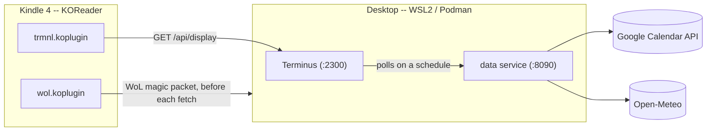
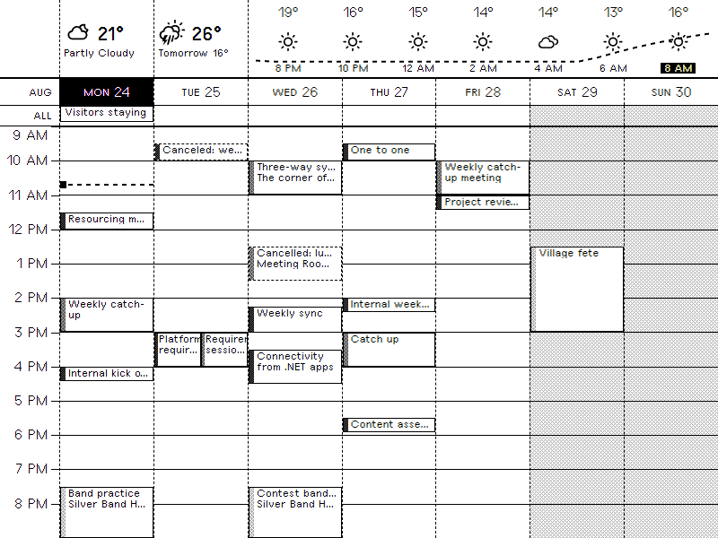

# wsl-trmnl-selfhost

Turns a Windows desktop into a self-hosted [TRMNL](https://usetrmnl.com) BYOS
(Bring Your Own Server) instance, driving an old jailbroken Kindle 4 running
[KOReader](https://github.com/koreader/koreader) as an e-ink calendar +
weather dashboard. No `trmnl.com` subscription, no cloud dependency, LAN-only.

Built for and tested with a Kindle 4 (800x600, 2-bit), but the server side is
device-agnostic.

## Why this exists

Amazon dropped support for old Kindles, so I jailbroke an old Kindle 4,
installed [KOReader](https://github.com/koreader/koreader), and set it up
with TRMNL cloud's free trial as a local display in our kitchen, the week
ahead across all our shared calendars, plus some useful weather info.

TRMNL's own hardware is great, but custom devices like this one need a flat,
one-off £38 fee per device, and this Kindle probably isn't a long-term
thing. So instead this became a weekend project: a self-hosted TRMNL server
that runs while I'm on my desktop (or wakes it from sleep if I'm not), renders
the same dashboard, and feeds it to the Kindle - no subscription, no
per-device fee.

The dashboard itself is [`trmnl-calendar-weather`](https://github.com/michaelwalshe/trmnl-calendar-weather),
a private TRMNL plugin I built separately. This repo replaces TRMNL's cloud
entirely: the same Liquid template runs against
[Terminus](https://github.com/usetrmnl/terminus), an official self-hosted
BYOS server, on a machine on your own network, with the calendar and weather
data supplied by a small companion service instead of TRMNL's own hosted
plugins.

## Architecture



Everything server-side runs in Podman inside WSL2 on the desktop:

- **Terminus** - the BYOS server itself. Renders the dashboard's Liquid
  template into an image and serves it to the Kindle.
- **The data service** (`app/`) - a small Flask app that fetches your
  Google Calendar events and Open-Meteo weather, shapes them into the JSON
  the Liquid template expects, and exposes it at `GET /data`. Terminus polls
  this on a schedule (its "Exchange" mechanism).
- **`wol.koplugin`** - a KOReader plugin that wakes the desktop over
  Wake-on-LAN before each fetch, since the desktop sleeps when idle.

### What it looks like



Rendered from `trmnl-calendar-weather`'s own sample data (not a real
calendar), see that repo's `tools/render.py` if you want to preview a
template change without a live server.

## Prerequisites

- Windows 11 with WSL2 (`wsl --version` >= 2.0.0, for mirrored networking)
- A jailbroken Kindle running KOReader - see
  [usetrmnl/trmnl-kindle](https://github.com/usetrmnl/trmnl-kindle) for the
  jailbreak itself (KOReader is their recommended method as of writing)
- The [`trmnl.koplugin`](https://github.com/usetrmnl/trmnl-koreader) KOReader
  plugin installed and able to reach `https://trmnl.app` (you'll repoint it
  at your own server below)
- A Liquid dashboard template designed for TRMNL's framework (e.g.
  [`trmnl-calendar-weather`](https://github.com/michaelwalshe/trmnl-calendar-weather))
- A Google account for calendar access (works with Google Calendar API
  regardless of what your actual calendar events come from - an M365 work
  calendar subscribed into Google Calendar shows up the same way a native
  Google event does)
- A router you can set a DHCP reservation on

## Setup

### 1. WSL2 + Podman

```powershell
wsl --install -d Ubuntu   # if you don't already have a distro
```

Copy the config templates, adjusting the placeholders:

- [`wsl/wsl.conf.example`](wsl/wsl.conf.example) → `/etc/wsl.conf` *inside*
  WSL (needs root)
- [`wsl/wslconfig.example`](wsl/wslconfig.example) → `%UserProfile%\.wslconfig`
  on the Windows side

Then `wsl --shutdown` and reopen a WSL terminal for both to take effect.

**Clone this repo natively inside WSL**, not onto a Windows path mounted via
`/mnt/c/...` - git and Docker builds are both meaningfully slower and less
reliable across that mount, and it's what the rest of this guide assumes:

```bash
git clone <this-repo-url> ~/wsl-trmnl-selfhost
cd ~/wsl-trmnl-selfhost
```

If you also want to edit the dashboard's Liquid template from Windows
tooling (see step 5), this WSL path is reachable from Windows at
`\\wsl.localhost\<distro-name>\home\<you>\wsl-trmnl-selfhost` - Explorer, VS
Code's WSL extension, and PowerShell can all use it directly, no separate
Windows-side copy needed.

Run the bootstrap script to install Podman and Docker Compose v2:

```bash
sudo bash wsl/bootstrap.sh
```

> **Why Podman, and why a manually-installed Compose v2 binary:** see the
> comments in `wsl/bootstrap.sh` and `wsl.conf.example` - short version,
> Podman avoids running Docker Desktop's Windows service/GUI layer, and the
> Ubuntu-packaged `docker-compose` is an old v1 release that can't parse a
> modern Compose file.

### 2. Networking

Mirrored networking (from step 1) makes WSL2 share the desktop's real LAN
IP, so the Kindle can reach containers running inside it directly. That
traffic still needs a firewall opening on the Windows side:

```powershell
# elevated PowerShell
& "\\wsl.localhost\Ubuntu\home\<you>\wsl-trmnl-selfhost\windows\setup-network.ps1"
```

This opens TCP 2300 (Terminus) and 8090 (the data service) through both the
Hyper-V firewall (specific to mirrored-mode WSL traffic) and the standard
Windows Firewall, and makes sure your network adapter is categorised
Private rather than Public.

Then set a **DHCP reservation** on your router for the desktop's MAC
address, so its LAN IP never changes, the Kindle needs a fixed address to
poll. Find the MAC with `Get-NetAdapter`.

### 3. Terminus

```bash
git clone https://github.com/usetrmnl/terminus ~/terminus
cd ~/terminus
bash bin/setup docker   # generates .env with DB/session secrets
```

Terminus auto-detects your machine's IP for `API_URI` in `.env`, open it
and confirm the port matches (`2300` by default), fixing it if the value
came out malformed (some versions leave a literal `$HANAMI_PORT` in there
instead of expanding it).

Copy this repo's Terminus config overrides in (both clones are siblings
under your home directory, per step 1):

```bash
cp ~/wsl-trmnl-selfhost/terminus/compose.override.yml ~/wsl-trmnl-selfhost/terminus/sanitize.yml ~/terminus/
```

Then:

```bash
docker compose up -d
```

Open `http://<desktop-lan-ip>:2300` and complete the first-run setup
(create your own admin login).

> **Why `sanitize.yml` needs overriding:** Terminus runs extension content
> through an HTML sanitizer that only allowlists 6 CSS custom properties by
> default. A Liquid template that styles itself with a plain `<style>`
> block (rather than only inline `style=""` attributes using framework
> utility classes) gets almost all of its CSS silently stripped,
> `display`, `position`, `grid-template-columns` and friends are fine
> (already covered by the sanitizer's `RELAXED` base config, confirmed by
> checking `Sanitize::Config::RELAXED` directly), but CSS custom properties
> and the `place-content` shorthand are not. This override widens the
> allowlist by exactly the properties `trmnl-calendar-weather`'s template
> needs, checked against the base config rather than guessed, see the
> comments in `terminus/sanitize.yml` for the reasoning. TRMNL's own cloud
> doesn't sanitize private-plugin content this way, so this isn't Terminus
> matching an intentional trust boundary, just filling a gap between the
> two.
>
> This is a config override layered on top via a Docker bind mount
> (`terminus/compose.override.yml`), not a patch to Terminus's own image or
> code, it survives `git pull`/image upgrades on the Terminus side
> cleanly.

### 4. Data service

```bash
cd app
uv sync
```

**Google Calendar**, one-time, interactive:

1. [Google Cloud Console](https://console.cloud.google.com) → new project →
   enable the Calendar API → OAuth consent screen (External, add yourself
   as a test user) → Credentials → OAuth client ID, type **Desktop app**.
2. Download the client secret JSON, save it as `secrets/client_secret.json`
   (relative to the repo root, `secrets/` is gitignored).
3. Authorise (from the `app/` directory, per the `cd app` above):
   ```bash
   uv run authorize_google.py
   ```
   Opens (or prints) a Google consent URL; approving it writes
   `secrets/google_token.json`, a refresh token used indefinitely from then
   on. Scope is `calendar.readonly`, this can never modify your calendar.

**Weather**: no API key needed (Open-Meteo is free/keyless). Copy
[`.env.example`](.env.example) to `.env` and fill in your coordinates,
resolve a place name with Open-Meteo's own geocoding API:

```bash
curl "https://geocoding-api.open-meteo.com/v1/search?name=<your town>&count=1"
```

Then bring it up (from the repo root, where `compose.yml` lives):

```bash
cd ..
docker compose up -d
```

`GET http://localhost:8090/data` should return calendar + weather JSON.
`GET /health` is the container healthcheck endpoint.

> **On duplicate calendar events:** if the same meeting exists on more than
> one calendar you have access to (common when a work calendar is synced
> into a personal Google account), `app/gcal.py` deduplicates by
> `(summary, start, end)`, preferring your primary calendar's copy. Without
> this, the dashboard's day grid draws real but visually-confusing overlaps
> for what's actually one meeting.
>
> **On event descriptions:** deliberately never fetched from Google (the
> API `fields` parameter excludes them), they routinely carry Teams/Zoom
> dial-in PINs and attendee email lists, which is more than a dashboard
> needs to request over the network even before considering whether to
> display it.
>
> **On hiding events:** set `EXCLUDED_EVENT_SUMMARY_PATTERNS` in `.env` to a
> comma-separated list of patterns (case-insensitive substring match, or a
> full regex) to drop any event whose summary matches one, e.g.
> `EXCLUDED_EVENT_SUMMARY_PATTERNS=Complete Timesheet` to hide a recurring
> reminder you don't want on the dashboard. Leave unset to show everything.
>
> **On hiding whole calendars:** set `EXCLUDED_CALENDAR_SUMMARIES` in `.env`
> to a comma-separated list of calendar names (case-insensitive exact
> match, not a pattern) to skip a calendar entirely -- e.g. one you're
> subscribed to but don't want on the dashboard at all.

### 5. The Liquid template

This repo doesn't vendor a copy of the dashboard's `full.liquid`, that
lives in its own template repo and would just go stale here. Run from
Windows (this writes into the WSL clone via its `\\wsl.localhost\...` path,
same as step 1):

```powershell
& "\\wsl.localhost\Ubuntu\home\<you>\wsl-trmnl-selfhost\liquid\build.ps1" -UpstreamPath C:\path\to\trmnl-calendar-weather
```

This concatenates [`_terminus_header.liquid`](liquid/_terminus_header.liquid)
+ the upstream `full.liquid` + [`_terminus_footer.liquid`](liquid/_terminus_footer.liquid)
into `liquid/full.terminus.liquid`. The header/footer do two things the
original template doesn't need to worry about, since they're specific to
how Terminus's rendering model differs from TRMNL cloud's:

1. **Alias `source_1.*` to the variable names the template expects.**
   TRMNL cloud's "Plugin Merge" strategy resolves `calendar_source` /
   `weather_source` / `hourly_source` as top-level variables directly.
   Terminus's Extension "Poll" mechanism instead lands whatever an Exchange
   URL returns under `source_1` (`source_2` for a second exchange, etc.),
   since the data service returns one JSON object with all three keys under
   a single exchange, the header just aliases them back.
2. **Supply the `.screen`/`.view` wrapper div.** TRMNL cloud's renderer
   wraps plugin content in this automatically; Terminus's extension
   renderer drops your HTML straight into `<body>` with no wrapper at all.
   Without it, the framework CSS driving the day-grid's sizing has nothing
   to attach to and the whole layout collapses to unstyled block flow.

### 6. Extension, Model, Device, Playlist

Terminus has a real, documented REST API for Models, Devices, Playlists and
Screens (`doc/api.adoc` in a Terminus checkout; JWT auth via `POST /login`
with the admin email/password you set during first-run setup), but
**Extensions and Exchanges have no API at all**, checked directly against
Terminus's own routes (`app/actions/api/` has devices, models, playlists,
screens, setup, display, log, firmware; no extensions). The two scripts
here reflect that split: one talks to the real API, the other drives
Terminus's internal Ruby classes directly (the same ones its own web forms
call), which works today but depends on internals that could change in a
future Terminus release without notice, the manual UI steps underneath
each script always still work if it ever breaks.

This is a two-pass workflow, because the Playlist step needs a Screen that
only exists after a Build, and the Build needs a Model that only exists
after the first pass:

> **`INTERVAL`/`UNIT` set how often Terminus polls the Exchange and
> rebuilds the screen -- not how often the device fetches.** `GET
> /api/display` (what the Kindle calls) always serves whatever screen is
> currently built; it never renders on demand (confirmed against
> `app/actions/api/display/show.rb`, which just returns the device's
> current Playlist screen). Set this shorter than, and independent of, how
> often your device actually polls -- e.g. every 15 minutes here even
> though the Kindle itself might only fetch every couple of hours over
> Wake-on-LAN (see step 9) -- so whatever the device does see is never far
> out of date. Terminus supports minute-level granularity
> (`app/aspects/croner.rb`); a `unit` of `"none"` disables scheduled
> rebuilds entirely (the extension will never update itself), so don't
> leave it there by accident.

**Pass 1 - create the Extension, Exchange, and Model:**

```bash
# Extension + Exchange (no REST API for these, see manage_extension.rb's
# own header comment for exactly what it does and why).
docker cp terminus/api/manage_extension.rb terminus-web-1:/tmp/manage_extension.rb
docker cp liquid/full.terminus.liquid terminus-web-1:/tmp/full.terminus.liquid
docker exec \
  -e EXTENSION_NAME=week_and_weather \
  -e EXTENSION_LABEL="Week and Weather" \
  -e TEMPLATE_FILE=/tmp/full.terminus.liquid \
  -e EXCHANGE_URL=http://<desktop-lan-ip>:8090/data \
  -e INTERVAL=15 -e UNIT=minute \
  terminus-web-1 bash -c 'cd /app && bundle exec ruby /tmp/manage_extension.rb'

# Model + Device (real API), MAC is your Kindle's, found via
# KOReader's Menu -> Network -> Info. This first run will get as far as
# creating the Model and Device, then stop with a clear message once it
# can't find a Screen yet, that's expected, keep the printed model id for
# pass 2 (the Device API key you'll need for step 8 only prints once the
# script completes successfully, i.e. after pass 2).
export TERMINUS_URL=http://<desktop-lan-ip>:2300
export TERMINUS_LOGIN=<your Terminus admin email>
export TERMINUS_PASSWORD=<your Terminus admin password>
export DEVICE_MAC=<kindle-mac-address>
bash terminus/api/setup.sh
```

`setup.sh`'s Model is deliberately `800x600, bit_depth 2, rotation 0` by
default (`MODEL_WIDTH`/`MODEL_HEIGHT`/`MODEL_LABEL`/`MODEL_NAME` env vars
override it), **don't reuse one of Terminus's seeded device models
without checking its Rotation value first**: several ship with
`Rotation: 90` baked in for portrait-native e-readers, which silently
rotates an otherwise-correct landscape render. Custom models also need
their `css` field populated with something valid
(`{"classes": {}, "variables": []}`, which is what both scripts set),
Terminus's `Model#css_classes` throws on a `nil` CSS field for a custom
model, surfacing as an unexplained 500 error when building/previewing.

**Pass 2 - build the screen, then finish the Playlist/Device wiring:**

```bash
# Re-run manage_extension.rb with BUILD_MODEL_ID set to the id setup.sh
# printed, to trigger a build for that model.
docker exec \
  -e EXTENSION_NAME=week_and_weather -e EXTENSION_LABEL="Week and Weather" \
  -e TEMPLATE_FILE=/tmp/full.terminus.liquid \
  -e EXCHANGE_URL=http://<desktop-lan-ip>:8090/data \
  -e INTERVAL=15 -e UNIT=minute -e BUILD_MODEL_ID=<model-id-from-pass-1> \
  terminus-web-1 bash -c 'cd /app && bundle exec ruby /tmp/manage_extension.rb'

# Re-run setup.sh with the same env vars as before, the screen exists
# now, so this proceeds to create the Playlist and assign it to the Device.
bash terminus/api/setup.sh
```

Both scripts are safe to re-run any time afterwards (e.g. after changing
the template or the schedule), everything is found-or-created by matching
name/MAC, never blindly duplicated.

If you'd rather do any of this through the UI instead, open
`http://<desktop-lan-ip>:2300`: **Extensions → New** (Kind: Poll, paste
`full.terminus.liquid` into Template, add an Exchange with the data
service's URL) → **Models → New** → **Build** the extension for that model
→ **Playlists → New**, add the built screen → **Devices**, set its Model
and Playlist.

### 7. Autostart

```powershell
# elevated PowerShell
& "\\wsl.localhost\Ubuntu\home\<you>\wsl-trmnl-selfhost\windows\setup-autostart-task.ps1"
```

Registers a Task Scheduler task that boots the WSL distro at both Windows
startup and logon (S4U logon type, no password stored, and works even
if nobody actually logs into Windows after a remote wake). Once WSL boots,
enable the systemd unit that brings the containers up:

```bash
cp wsl/trmnl-stack.service ~/.config/systemd/user/
systemctl --user daemon-reload
systemctl --user enable --now trmnl-stack.service
```

> **Two things this specifically works around**, both confirmed the hard
> way rather than assumed:
>
> - Podman's rootless `restart: unless-stopped` policy needs a
>   per-container supervisor process that's still alive to act on it. That
>   does not survive a full WSL VM cold-boot (unlike Docker Engine's
>   persistent daemon), after a real restart, containers were found
>   sitting in "Created" but never started. `trmnl-stack.service` explicitly
>   runs `docker compose up -d` on boot instead of relying on the restart
>   policy alone.
> - WSL has its own idle-shutdown feature (`instanceIdleTimeout` /
>   `vmIdleTimeout`, ~60 seconds by default) that stops the whole VM when
>   no `wsl.exe` process is attached, regardless of systemd or containers
>   actively running inside. This silently killed the server repeatedly and
>   looked exactly like a crash. `wslconfig.example` disables both.

### 8. Kindle: KOReader plugins

**`trmnl.koplugin`** (the display client, install per its own
[README](https://github.com/usetrmnl/trmnl-koreader) if you haven't
already):

1. **Tools → TRMNL Display → Configure TRMNL**: **Base URL** =
   `http://<desktop-lan-ip>:2300`, **API Key** = the one `setup.sh` printed
   in step 6.
2. **Tools → TRMNL Display → Fetch screen now** to test.

(If you skipped the automation scripts and did step 6 entirely via the UI
instead, get the API key from that Device's page in Terminus rather than
from a script's output.)

**`wol.koplugin`** (this repo's own plugin, wakes the server before each
fetch, since the desktop sleeps when idle):

Deploy it with the included script (auto-detects the Kindle's USB drive
letter):

```powershell
& "\\wsl.localhost\Ubuntu\home\<you>\wsl-trmnl-selfhost\koreader\deploy-to-kindle.ps1"
```

Then on the Kindle:

1. **Tools → Wake TRMNL Server → Configure**: your desktop's MAC address,
   broadcast address (your subnet's `.255`, e.g. `192.168.1.255`), wake
   lead time (how long to wait after sending the packet before fetching,
   start around 30s, tune down once you've seen how fast your desktop
   actually responds), and interval.
2. **Tools → Wake TRMNL Server → Enable auto wake-and-fetch**.
3. Go back into **Tools → TRMNL Display** and disable **its** own
   auto-refresh, `wol.koplugin` now drives the whole cycle (wake, wait,
   trigger `trmnl.koplugin`'s fetch via KOReader's own event system), so
   you don't want two independent schedules running.

If something silently fails, `crash.log` on the Kindle (root of the drive
it mounts as, inside `/koreader/`) is the actual place to look, KOReader
keeps running other plugins even if one errors, so failures don't surface
in the UI on their own.

> **Why disabling `trmnl.koplugin`'s auto-refresh doesn't just skip a
> redundant timer.** That auto-refresh also calls
> `UIManager:preventStandby()` to keep the device from sleeping between
> refreshes, disabling it therefore also re-enables normal sleep, and
> nothing else was replacing that. Worse, `preventStandby()` is a no-op on
> Kindle anyway (`canStandby()` is `false` for every Kindle model in
> KOReader; it's a lighter power state Kindle hardware doesn't expose
> there), and an RTC wakeup alarm isn't available either
> (`Device.wakeup_mgr` only gets set up if `liblipclua` loaded, which on a
> Kindle 4 jailbreak it may not). `wol.koplugin` works around this itself:
> while auto-wake is enabled it shells out to
> `lipc-set-prop com.lab126.powerd preventScreenSaver 1/0`, the same
> mechanism KOReader's own bundled `keepalive.koplugin` uses for Kindle.
> Without it, the device fully suspends after its normal idle timeout and
> `UIManager:scheduleIn` (what drives the wake schedule) simply doesn't run
> again until something else wakes the device -- confirmed against
> KOReader's own frontend source (`frontend/device/kindle/powerd.lua`,
> `frontend/ui/uimanager.lua`), not guessed.

### 9. Power management

Wake-on-LAN is very likely your only remote-wake option (few consumer
motherboards expose a scheduled/RTC wake setting in BIOS, and if yours
doesn't either, WoL is the fallback either way):

1. **BIOS**: enable Wake-on-LAN (often labelled `S4/S5 Wake on LAN` or
   similar, under Power/Advanced settings).
2. **Windows**: confirm the NIC is armed for wake,
   `powercfg -devicequery wake_armed` should list it. If not, Device
   Manager → the adapter → Power Management tab -> allow it to wake the
   computer.
3. **Use S3 standby as the normal "off" state, not a full shutdown.**
   Confirmed by testing both: S3 sleep reliably resumes via WoL *and*
   Terminus resumes automatically with zero manual intervention once
   Windows is back. A full shutdown (S4/S5) did not reliably wake via WoL
   on the hardware this was built against, even with the BIOS setting
   enabled, worth checking on your own hardware, but don't assume it
   works without testing.
4. **Force a screen rebuild on every resume from sleep**, so a device
   polling shortly after a WoL wake doesn't get whatever was already stale
   when the desktop went to sleep:
   ```powershell
   # elevated PowerShell
   & "\\wsl.localhost\Ubuntu\home\<you>\wsl-trmnl-selfhost\windows\setup-resume-rebuild-task.ps1"
   ```
   Shortening the Extension's poll interval (step 6) only bounds staleness
   while the desktop stays awake between polls -- it does nothing for the
   time the desktop spent asleep. Terminus's scheduler discards a poll
   tick that was missed while suspended rather than catching up on it
   (confirmed in rufus-scheduler's own source, `discard_past` defaults to
   `true`), so left alone it just waits for the next aligned interval
   boundary after waking, which can be nearly a full interval away
   regardless of how long the desktop was asleep. This task instead
   triggers an immediate rebuild on the standard Windows "resumed from
   sleep" event, independent of any poll schedule. In testing this took
   about 40 seconds end to end, so make sure `wol.koplugin`'s wake lead
   time (step 8) comfortably exceeds that.

## Using a different dashboard template

Steps 4-6 above are specific to `trmnl-calendar-weather`'s data shape. To
drive a different Liquid dashboard (your own, or someone else's) instead:

1. **Work out what data the template expects.** Check its own
   `settings.yml`/README for the variable names it reads (e.g.
   `calendar_source`, `weather_source`) and their shape, that's the
   contract your data service needs to satisfy.
2. **Write or adapt a data service.** `app/` is a small Flask app that
   returns one JSON object at `GET /data`, copy its structure (env-driven
   config, a `/health` endpoint for the Docker healthcheck, one function per
   data source) and swap in whatever the new template needs. If the template
   is self-contained and needs no external data, you can skip this service
   entirely and point the Exchange at any URL that returns the right JSON.
3. **Re-check the two Terminus-specific adaptations from step 5**, they
   apply to any Liquid template running as a Terminus extension, not just
   this one:
   - Terminus's Exchange mechanism lands your data service's response under
     `source_1` (`source_2` for a second exchange, etc.), not as top-level
     variables, alias it in a header partial the way
     `_terminus_header.liquid` does, or write the template to read from
     `source_1` directly.
   - Terminus's extension renderer doesn't supply the `.screen`/`.view`
     wrapper div that TRMNL cloud's renderer adds automatically, most
     TRMNL framework templates need it re-added
     (`_terminus_header.liquid`/`_terminus_footer.liquid` do this by
     wrapping the template's own output).
4. **Check the sanitizer** (see step 3) if the new template's `<style>`
   block uses CSS properties beyond what `terminus/sanitize.yml`'s allowlist
   already covers, check `Sanitize::Config::RELAXED` inside the Terminus
   container directly rather than guessing, the same way this repo's own gap
   (CSS custom properties, `place-content`) was found.
5. **Repeat step 6** (Extension/Model/Device/Playlist) with the new template
   file and a new `EXTENSION_NAME`/`EXCHANGE_URL`, both scripts are
   generic and don't assume `trmnl-calendar-weather` specifically anywhere.

If the template already targets TRMNL's framework CSS (most public TRMNL
plugins do), most of this still applies as-is, the real per-template work
is steps 1 and 2, matching whatever data shape the new template wants.

## Repo layout

```
app/                Data service (Google Calendar + Open-Meteo -> JSON)
docs/               README images
terminus/           Config overrides applied on top of a Terminus checkout
terminus/api/       Automation: real API (Model/Device/Playlist) + internal (Extension/Exchange)
liquid/             Adapts a TRMNL Liquid template to run as a Terminus extension
koreader/           wol.koplugin, plus a deploy script
wsl/                WSL2/Podman setup: bootstrap script + config templates
windows/            Windows-side PowerShell setup scripts
```

## License

MIT, see [LICENSE](LICENSE).
